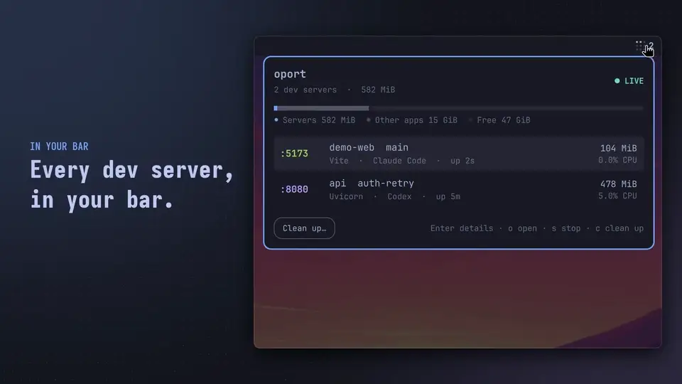
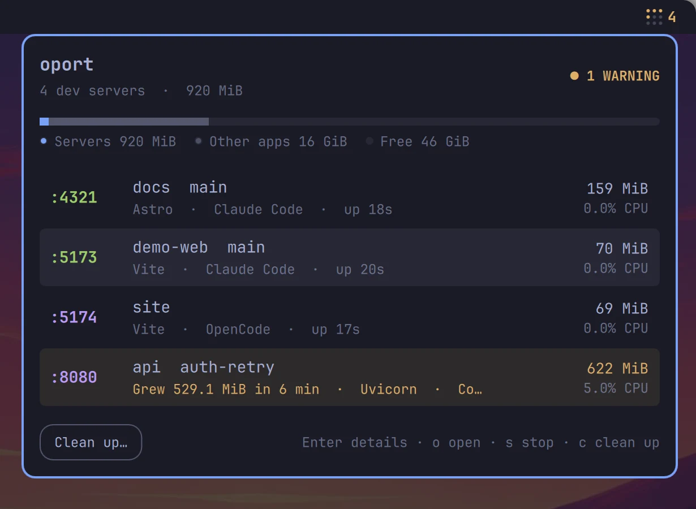
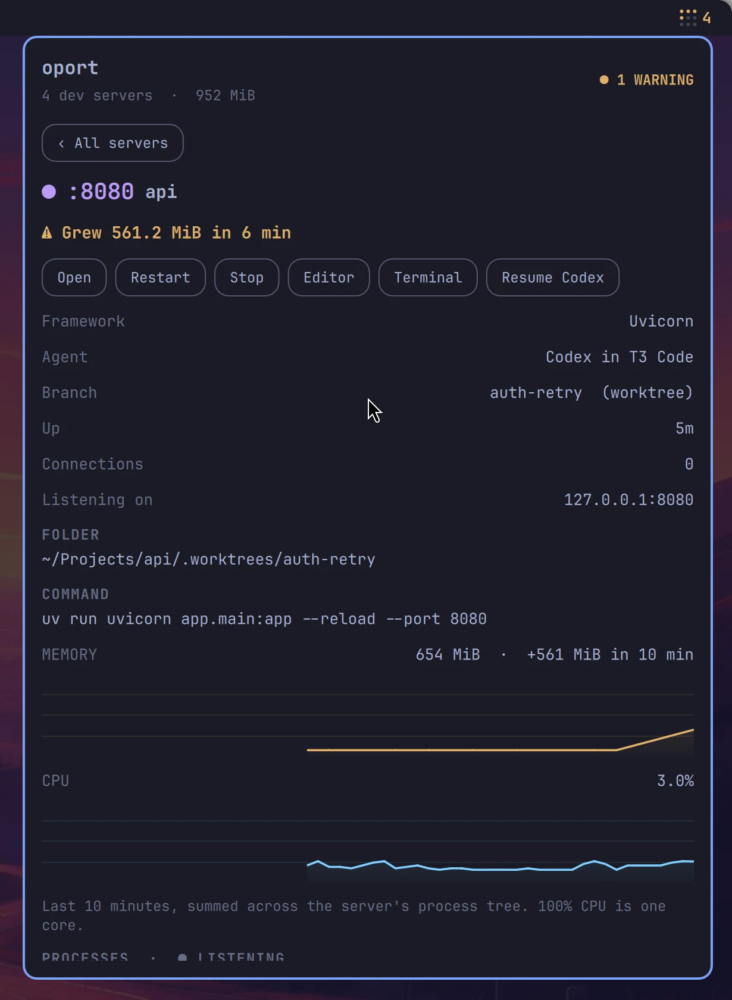

# oport

**oport lists every dev server running on your machine, in the Omarchy bar.**
It is for developers on [Omarchy](https://omarchy.org) who leave `npm run dev`,
Vite, Django or Rails servers running across projects and coding-agent
sessions. For each server it shows the port, project, branch, memory and CPU,
and which agent started it. It warns when a server leaks memory, and stops,
restarts or cleans up servers in one click.

oport is an Omarchy port of [WhatThePort](https://whattheport.dev/). A Rust CLI
scans `/proc`. A Quickshell bar plugin shows the results.

[](https://kierangraham.com/media/promo/oport.mp4)

[Watch the film (33 s, with sound)](https://kierangraham.com/media/promo/oport.mp4)

## Install

oport has two parts, and you install them separately:

- **The `oport` CLI.** It finds the servers. The bar plugin runs it.
- **The bar plugin.** `omarchy plugin add` installs it from this repository.

### 1. Install the CLI

**You need a Rust toolchain, 1.95 or newer.** Arch's `rust` package is recent
enough:

```bash
sudo pacman -S --needed base-devel git rust
```

Then install the CLI one of these ways, in order of preference.

**The Arch package.** It installs `/usr/bin/oport` and nothing else. Omarchy
manages the plugin folder, so the package leaves the plugin out.

```bash
git clone https://github.com/kierangraham/oport
cd oport/packaging/arch
makepkg -si
```

**Cargo.** It installs `~/.cargo/bin/oport`.

```bash
cargo install --git https://github.com/kierangraham/oport --tag v0.1.0 --locked
```

**Make, from a clone.** It installs `~/.local/bin/oport`. Set `PREFIX` to
install elsewhere.

```bash
git clone https://github.com/kierangraham/oport
cd oport
make install
```

The plugin looks for the CLI in `~/.local/bin`, `~/.cargo/bin`,
`/usr/local/bin` and `/usr/bin`, in that order, then on `PATH`.

### 2. Add the plugin

```bash
omarchy plugin add https://github.com/kierangraham/oport --enable
```

**A dot grid appears on the right of the bar.** Click it to open the panel.

## Update

Update the CLI the same way you installed it:

| Installed with | Update with |
| --- | --- |
| Arch package | `git pull` in the clone, then `makepkg -si` in `packaging/arch` |
| Cargo | `cargo install --git https://github.com/kierangraham/oport --tag <new tag> --locked` |
| Make | `git pull`, then `make install` |

Then update the plugin:

```bash
omarchy plugin update kierangraham.oport
```

## Uninstall

```bash
omarchy plugin remove kierangraham.oport --yes
```

Then remove the CLI:

| Installed with | Remove with |
| --- | --- |
| Arch package | `sudo pacman -R oport` |
| Cargo | `cargo uninstall oport` |
| Make | `make uninstall` in the clone |

## Usage

### The bar

The bar shows a 3×3 dot grid, with one lit dot per server, up to nine, and
the server count.

- **Amber grid.** A server is using too much memory.
- **Hover.** Shows a summary.
- **Click.** Opens the panel.
- **Right-click.** Opens the panel at **Clean up**.

oport never sends desktop notifications.

### The panel



The panel has three views:

- **List.** One row per server. Each port keeps its colour. Hover a row to open
  it in the browser or stop it. A bar splits RAM into dev servers, other apps
  and free memory.
- **Details.** Click a row. It shows the agent session and its host app, the
  branch and worktree, folder, command, listening addresses and connections.
  It also has 10-minute memory and CPU charts and every process in the tree.
- **Clean up.** Lists servers with checkboxes. **Servers whose folder was
  deleted, or that have been idle for hours, start selected.** Stop them
  together.



The details view has these buttons:

| Button | Does |
| --- | --- |
| **Open** | Opens the server in the browser |
| **Restart** | Stops the server, then reruns its command |
| **Stop** | Stops the server and its child processes |
| **Editor** | Opens the folder with `omarchy-launch-editor` |
| **Terminal** | Opens a terminal in the server's folder |
| **Resume** | Reopens the Claude Code or Codex conversation that started the server, in a terminal |

**Stop, Restart and Clean up ask for a second click.**

Keys in the panel:

| Key | Does |
| --- | --- |
| Up, Down or `j`, `k` | Select a server |
| Enter | Open details; in Clean up, tick or untick |
| `o` | Open in the browser |
| `s` | Stop; in Clean up, stop the ticked servers |
| `r` | Restart |
| `e` | Open in the editor |
| `t` | Open a terminal |
| `c` | Clean up |
| Escape | Go back, or close the panel |

Shell commands:

```bash
omarchy-shell oport open | close | toggle
omarchy-shell oport status     # {"ready":true,"servers":3,"leaking":0,...}
```

### In a terminal

`oport` on its own opens an interactive view with the same list, details and
clean up. It supports mouse clicks and scrolling. Press `?` for keys.

```bash
oport list                 # table, then exit
oport list --json          # for scripts and agents
oport stop :3000 :5173     # a port, pid:N, or an id from --json
oport restart 3000         # stop, then rerun its command, detached
oport open 3000
oport cleanup --dry-run    # servers whose folder was deleted
oport watch                # one JSON snapshot per line (the bar's data source)
```

- **`--all`** includes every listening process, not only dev servers.
- **Restarted servers** run in their own session. They log to
  `~/.local/state/oport/logs/`.

## Configuration

Change settings in the bar's widget settings. Omarchy stores them on the
widget's entry in `~/.config/omarchy/shell.json`. The CLI and terminal view
read the same entry. Flags such as `--memory-limit`, `--ports` and
`--idle-hours` override it.

| Key | Default | Meaning |
| --- | --- | --- |
| `memoryLimitMb` | 2048 | Warn above this; 0 turns it off |
| `growthMb`, `windowMinutes` | 500, 10 | Warn on this much growth within the window |
| `idleHours` | 3 | Hours before a quiet server counts as idle; 0 turns it off |
| `graceSeconds` | 5 | Delay before force-quitting |
| `portMin`, `portMax` | 1024, 32767 | Ports scanned; the upper default skips ephemeral ports |
| `protected` | postgres, redis-server, … | Comma-separated process names |
| `ignored` | | Process or project names to leave out |
| `showAll` | false | Every listening process, not only dev servers |
| `showCount`, `hideWhenEmpty` | true, false | Bar appearance |

**Keyboard shortcut.** WhatThePort uses ⌥⌘P. For the same on Omarchy, add a
Hyprland binding:

```
bind = SUPER ALT, P, exec, omarchy-shell oport toggle
```

**CLI location.** To run a CLI from somewhere else, set `OPORT_BIN` in the
shell's environment.

## How it works

- **Discovery.** oport reads listening TCP sockets from `/proc/net/tcp` and
  `tcp6`. It matches socket inodes to processes through `/proc/<pid>/fd`.
  It can only inspect your own processes, so root-owned listeners such as
  `docker-proxy` don't appear. The scan runs every two seconds.
- **One server per process tree.** From the listening process, oport climbs
  through launchers that only wrap it, such as `npm run dev`, `pnpm`, `sh -c`,
  `cargo watch` and Django's reloader. It never climbs into an interactive
  shell, terminal, tmux or coding agent. A task runner such as `turbo` stays
  out when it hosts several servers, so monorepo apps stay separate. A process
  serving several ports is one entry with all of them.
- **Dev servers.** A listener counts as a dev server in either case:
  - its folder is inside a project under your home directory, marked by
    `package.json`, `Cargo.toml`, `go.mod`, `pyproject.toml`, `Gemfile`,
    `mix.exs`, a git repository or similar
  - it runs a dev runtime such as node, bun, deno, python or ruby

  oport counts other listeners as hidden.
- **Project, framework, branch.** The nearest manifest names the project.
  Monorepo apps keep their own name, with the repository beside it. The
  framework comes from the command line, then `package.json` dependencies.
  The branch comes from `.git/HEAD`, including linked worktrees.
- **Agents.** Claude Code sets `CLAUDE_CODE_SESSION_ID` and Codex sets
  `CODEX_THREAD_ID` for the commands they run. The server's environment
  therefore names the exact session to resume. oport recognises OpenCode,
  Gemini CLI, Amp, Aider, Goose and Crush as ancestor processes. It reports
  T3 Code, Zed and VS Code as the host app.
- **Memory and CPU.** Memory is proportional set size (PSS), summed over the
  process tree, so shared libraries count once. CPU is summed over the tree.
  One logical core is 100%.
- **Leaks.** oport flags a server above 2 GiB, or when it grows by 500 MiB
  within 10 minutes. It waits for two minutes of history first, so startup
  allocation doesn't count. **Clean up never preselects a leaking server.**
- **Idle.** A server is idle after three hours with under 2% CPU and no
  established connections. An open browser tab with a hot-reload socket keeps
  a server active.
- **Stop.** oport sends SIGTERM to the server's tree, children first. After
  five seconds it sends SIGKILL to anything still running. It checks every pid
  against its start time, so it never signals a recycled pid. **Databases and
  container daemons are protected.** Clean up never preselects them, and the
  CLI needs `--force` to stop them.

## Not yet ported

These WhatThePort features are missing:

- automatic clean up; only Ask mode exists
- pull-request and Vercel preview links
- idle detection in one-shot CLI commands; `cleanup` uses deleted folders only
- translations

## Development

| Command | Does |
| --- | --- |
| `make check` | Runs `cargo fmt`, tests and clippy, a release build, `omarchy plugin validate` and the model tests |
| `make build` | Builds `target/release/oport` |
| `make install` | Installs the CLI to `$(DESTDIR)$(PREFIX)/bin`; `PREFIX` defaults to `~/.local` |
| `make uninstall` | Removes it again |
| `./tests/qml-smoke` | Loads the plugin on Wayland with every window hidden |
| `./tests/qml-smoke --render` | Renders each view offscreen into `tests/output/` |
| `./scripts/install` | Installs the CLI and a copy of the plugin from this checkout |

`make check` needs Omarchy and Node.js.

Both QML runs start a throwaway `npm run dev` project on port 5199. They drive
the list, details and clean-up views against the live scanner. Layer-shell
windows can't load offscreen, so `--render` swaps `tests/shim/` in for
Omarchy's KeyboardPanel. Every other component is the installed one.

The plugin's QML is in `plugin/`. `manifest.json` sits at the repository root
so `omarchy plugin add` can install from git.

`./scripts/install` refuses to replace a plugin folder it didn't create.
Remove a git-installed copy before you use it.

## Licence

MIT. See [LICENSE](LICENSE). oport is an independent project, unaffiliated
with WhatThePort. Only its public website and README were consulted.

---

[kierangraham.com](https://kierangraham.com)
